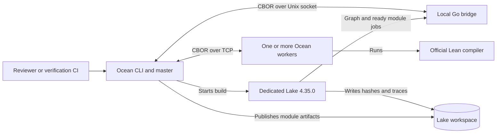

# Architecture Overview

Ocean distributes Lean verification builds across trusted Linux hosts. A reviewer runs `ocean` in a Lake project, and the master returns the compiled artifacts to that project's ordinary Lake workspace. Update this document when the Lake integration, scheduler, worker protocol, or artifact layout changes.

## 1. Project Structure

```text
.
├── main.go                     # CLI, worker command, and local Lake bridge
├── master.go                   # Worker registration, scheduling, and artifact publication
├── job.go                      # Compiler jobs, source snapshots, and path relocation
├── snapshot.go                 # Compressed source archive and verified extraction
├── worker.go                   # Input cache and remote Lean execution
├── wire.go                     # Framed CBOR messages and checked file transfers
├── internal/adapter/patch.py   # Hooks applied to the pinned upstream Lake sources
├── scripts/
│   ├── build                   # Build Ocean and the dedicated Lake adapter
│   ├── test-compose            # Run the two- and three-worker integration scenarios
│   ├── benchmark               # Compare clean Mathlib builds with Lake and Ocean
│   └── report.py               # Summarize timing and per-attempt events
├── integration_test.go         # Wire, disconnect, and Compose tests
├── tests/project/              # Lean fixture with a diamond-shaped import graph
├── Dockerfile                  # Shared test image with Go and pinned Lean
├── compose.yaml                # One master and a scalable slave service
├── README.md                   # Setup, invocation, and benchmarking
└── PLAN.md                     # Project goals, research references, and milestones
```

`scripts/build` generates the adapter workspace under `.ocean/lake/` and the executable entry points under `bin/`. The handwritten Go code lives in a single package at the project root.

## 2. High-Level System Diagram



Lake resolves targets, imports, and freshness. The resolved graph lets the master start sending the compressed source snapshot while Lake prepares local prerequisites. The master selects a seeded worker for each ready compilation. That worker requests any missing job inputs, runs Lean in its relocated workspace, and returns diagnostics and artifacts. The master stages and validates the results before publishing them. Lake then finalizes the job and can release its dependents. The module files stay on the reviewer machine for later use with ordinary Lake.

## 3. Core Components

### CLI and local bridge

`main.go` implements `ocean`, `ocean-worker`, and the internal bridge commands in one Go binary. `ocean` consumes leading `--ocean-config` and `--ocean-policy` options and forwards Lake arguments in order. Distributed routing is enabled for configured `build` invocations with a compatible toolchain and workers. Other commands and builds without compatible workers use stock Lake.

### Lake adapter

`internal/adapter/patch.py` adds hooks to the Lean 4.35.0 sources at build time. The adapter reports the resolved root-package import graph and submits eligible module compilations with their effective compiler arguments and `ModuleSetup`. It exchanges JSON with the local Go bridge over process I/O. The bridge relays work to the master over a private Unix socket. Lake handles dependency package builds, native compilation, custom actions, and compiler fallback locally.

### Master and scheduler

`master.go` holds the worker slots and pending jobs in memory for one build. `job.go` maps source, toolchain, dependency, and output paths into a job manifest. The scheduler scores candidates by the length of the remaining dependency chain divided by one plus the number of active attempts. It discounts a replica's score by its estimated input preparation time. Missing input bytes break score ties.

- `single` allows one active attempt per module.
- `delayed` starts its timer once a worker has confirmed the inputs are ready. Replicas become eligible after the greater of one second or twice the moving estimate of the remaining attempt phase.
- `eager`, the default, allows replicas as soon as a module is ready. Attempts for the same module run on distinct worker host identities.

The first complete result that passes validation is published. Losing attempts receive cancellation, and late results are discarded. A transport failure can trigger another attempt on a different worker or a local fallback. Compiler failures are returned through Lake if no active attempt succeeds.

### Workers and transport

`worker.go` opens a persistent TCP connection to the master per compiler slot. Workers register their host identity, platform, Lean commit, and slot count. Each worker reuses verified files across jobs during a build and gives every compilation attempt a separate output directory.

`wire.go` defines the CBOR message and file formats. Frames use a four-byte big-endian length prefix with a 32 MiB limit. File contents are sent in chunks of up to 1 MiB. Request IDs correlate messages on a connection, and attempt IDs identify executions across the build.

## 4. Data Stores

| Store | Contents and lifecycle |
| --- | --- |
| Master Lake workspace | Published `.olean` files, companion artifacts, hashes, and traces in Lake-configured paths. Incoming results are staged beside their destinations before publication. |
| Master memory | Worker registrations, the ready queue, the import graph ranks, and file metadata and digests for the current invocation. |
| Worker temporary storage | A per-build SHA-256 blob store and relocated project tree, populated from tracked regular files and declared compile inputs. Attempt output directories are removed after each job. The worker removes its temporary data when it exits normally. |
| Event and benchmark files | Optional JSON Lines events record registration, snapshot transfer, job input preparation, dispatch, completion, publication, and elapsed build time. Benchmark transfer totals include source seeding. The benchmark keeps its logs, timing files, and `metrics.tsv` in the requested output directory. |

## 5. External Integrations

- **Lean and Lake.** The supported release is Lean 4.35.0. The dedicated adapter comes from upstream Lake sources, and workers invoke the official Lean compiler. Elan can provide the pinned toolchain for a local build of Ocean.
- **Git and GitHub.** Git supplies the tracked workspace file list. The benchmark fetches a pinned Mathlib revision, and Lake resolves its pinned dependencies. The Docker build downloads the Lean release from GitHub.

## 6. Deployment and Infrastructure

Run `ocean` on the machine holding the reviewer's workspace and `ocean-worker` on each participating host. Match the workers' Linux architecture and Lean commit to the master. The master reads `listen`, `workers`, `wait`, and optional `adapter` and `events` values from the TOML configuration. The default listener binds to `127.0.0.1:7431`.

Docker Compose packages the same binaries and provides the test topology. The `master` service hosts the test workspaces, and the `slave` service scales to two or three containers. Operational output comes from Lake, optional `OCEAN_DEBUG` diagnostics, and the event log.

## 7. Security Considerations

The deployment boundary is a trusted private network. Worker registration checks protocol and toolchain compatibility. The TCP transport uses plaintext, and network access controls are responsible for limiting who can connect. The local bridge socket lives in a private temporary directory.

SHA-256 and size checks verify files in transit. The relocation code validates relative path components and maps them to the workspace, selected toolchain, or attempt output directory. Build-time Lean code runs with the worker process's permissions, so the trust model includes both the source project and the worker hosts.

## 8. Development and Testing

With Go 1.26, Python 3, Git, and the pinned Lean toolchain installed, run `scripts/build` to generate local binaries. The README covers worker setup and the benchmark command. [Setup and verification](README.md)

- `go test ./...` exercises chunked CBOR transfer and disconnect recovery. Use `go test -race ./...` and `go vet ./...` when changing Go concurrency or transport code.
- `scripts/test-compose` exercises argument forwarding, cross-worker dependency ordering, eager replicas, compiler diagnostics, normal artifact placement, and reuse through official Lake.
- `scripts/benchmark` compares clean runs with stock Lake and Ocean's three policies. Pass a smaller target such as `Mathlib.Init` to check the runner before a full Mathlib build.

## 9. Roadmap

The next performance milestone is a clean, full Mathlib build on separate hosts. Measure elapsed time through artifact publication alongside worker CPU time, transferred bytes, and duplicate attempts. Use the results to evaluate compile-time weighting and the cost of replication. The longer-term workloads are Tau Ceti, Anthropic's Fermat's Last Theorem formalization, and OpenAI's Navier–Stokes formalization. [Goals and reference workloads](PLAN.md)

## 10. Project Identification

| Field | Value |
| --- | --- |
| Project | Ocean |
| Home | Current Ocean workspace |
| Standalone repository URL | https://github.com/tani/ocean |
| Primary contact | Unrecorded in the workspace |
| Last updated | 2026-11-21 |

## 11. Glossary

| Term | Meaning |
| --- | --- |
| Lake | Lean's build and package manager. |
| Master | The Go coordinator that runs alongside Lake on the reviewer's machine. |
| Worker or slave | A `ocean-worker` process on a participating host. `slave` is the Compose service name. |
| DAG | Directed acyclic graph. Each node is a Lean module and each edge represents an import dependency. |
| Attempt | A single execution of a module job. Speculation can launch multiple attempts for the same job. |
| CBOR | Concise Binary Object Representation, the encoding for Ocean's transport. |
| `.olean` | A compiled Lean module artifact that other modules can import. |
